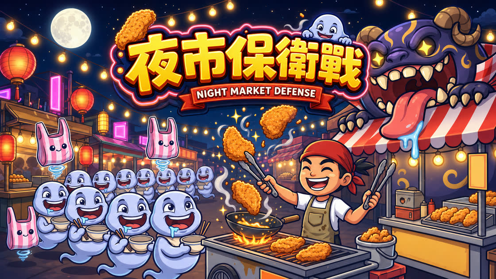
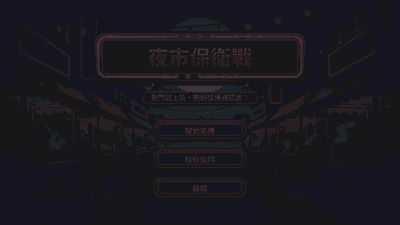

# 夜市保衛戰 Night Market Defense

在台灣夜市撐過十分鐘的妖怪潮。雞排迴旋鏢、臭豆腐毒霧、糖葫蘆環……六種小吃武器會自動出手，把嘴饞的妖怪通通餵飽；升級三選一、武器配上對的被動就能進化，最後打倒饕餮王，迎來天亮。

A top-down survivors-style game set in a Taiwanese night market. Survive ten minutes of hungry ghosts while six street-food weapons fire automatically to feed them full, then defeat the Taotie King before dawn.

## 下載遊玩 Download

到 [Releases](../../releases/latest) 下載 `NightMarketDefense-v1.0-windows.zip`，解壓縮後雙擊 `NightMarketDefense.exe` 就能玩，不用安裝。

Download the zip from [Releases](../../releases/latest), unzip, and run `NightMarketDefense.exe`. No install needed.

- 支援 Windows 10 / 11（64 位元）｜Windows 10 / 11, 64-bit
- 第一次開啟若跳出 Windows SmartScreen：按「其他資訊」→「仍要執行」。這是因為程式沒有付費數位簽章。
  If Windows SmartScreen appears, click "More info" → "Run anyway". The build is not code-signed.

## 操作 Controls

| 動作 Action | 按鍵 Key |
|---|---|
| 移動 Move | WASD／方向鍵 Arrow keys |
| 大招 Ultimate | Space |
| 選升級 Pick upgrade | 1・2・3 或滑鼠點選 / or click |
| 暫停 Pause | Esc／P |

武器會自動攻擊，你只要走位。打倒妖怪掉的銅板可以到攤位補給：彈珠台多一次升級、青草茶回血、射氣球加攻速。

Weapons attack on their own; you just move. Spend dropped coins at stalls: pinball for an extra level-up, herbal tea to heal, balloon darts for attack speed.

## 製作 Credits

- 設計與開發：陳品愷 Kevin Chen
- 引擎：[Godot Engine](https://godotengine.org) 4.7（MIT License）
- 字型：Noto Sans TC（SIL Open Font License）
